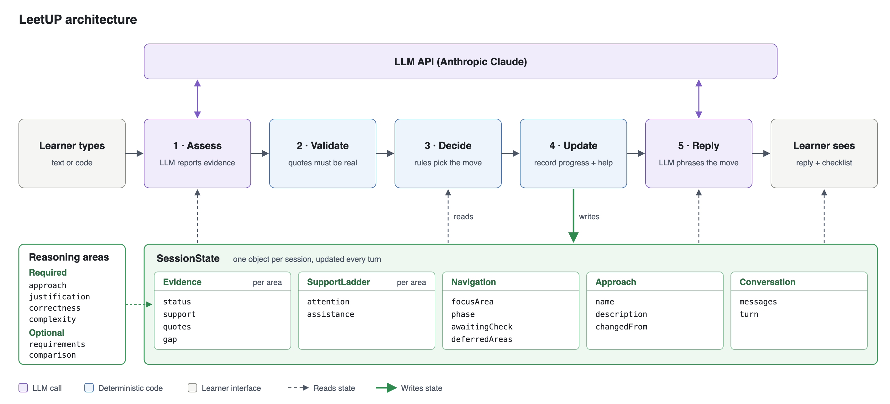

# LeetUP

LeetUP helps computing students practise explaining algorithmic decisions. In a guided conversation about a coding problem, learners propose an approach, justify it, consider correctness and edge cases, and explain its time and space costs. LeetUP asks follow-up questions and offers progressively stronger hints when needed. The current problem is [Two Sum](https://leetcode.com/problems/two-sum/); correct slower approaches are accepted when learners can explain them.

## Set up and run

1. Install Node.js 22 or newer and run `npm install`.
2. Copy `.env.example` to `.env` and set `ANTHROPIC_API_KEY` to your Anthropic API key.
3. Run `npm run dev` and open the local URL printed in the terminal.

LeetUP uses Anthropic's Messages API and Claude Sonnet 5.5 (`claude-sonnet-5-5`) by default. If you need a different Claude model, set `ANTHROPIC_MODEL` in `.env`. The local API server keeps the key out of browser code. `.env` is excluded from Git. To check a production build locally, run `npm run build` followed by `npm run preview`.

## Sharing an attempt

Learners can send explanations, code, or both. Code mode preserves indentation and displays the attempt as a code block. In code mode, Enter inserts a newline and Cmd/Ctrl+Enter sends; in text mode, Shift+Enter inserts a newline. Markdown code fences also work in text mode.

Code can demonstrate a concrete approach, but learners still need to explain their choices, correctness, edge cases, and complexity. LeetUP can discuss and manually trace code; it does not execute it. Learners may run their attempts in their own editor.

## How it works



The learner is the person typing in the chat. For each learner message, LeetUP calls Claude once to assess the learner's reasoning. Its policy code checks the evidence and decides which area to address and how much help to give. A second Claude call writes LeetUP's next reply. The policy controls checklist completion and reference-code release. Once the required reasoning is demonstrated, LeetUP can generate reference code matching the learner’s recorded algorithm. Approaches are not selected from a fixed list. The model assesses correctness against the problem and reasoning rubric; its judgments and generated code still require evaluation.

- `src/data/problemBank.ts`: Two Sum statement, examples, constraints, and problem context.
- `src/lib/llmProvider.ts`: rubric assessment, learner-specific hints, and gated reference-code generation.
- `src/lib/policy.ts`: evidence validation, hint sequence, and tutoring decisions.
- `src/types.ts`: the `SessionState` shape shown in the diagram.
- `src/lib/session.ts` and `src/lib/applyDecision.ts`: checklist and session state.
- `src/lib/summary.ts`: feedback derived from the evidence and support record.
- `src/lib/llmClient.ts`: browser requests to the local API.
- `src/lib/exportLog.ts`: Export MD / JSON buttons; each turn's assessment and policy decision, for test logs.
- `server/api.mjs`: local API that calls Anthropic.

### Session state

`SessionState` in `src/types.ts` is the record the policy reads and the Update step writes. Entity names group its fields by purpose; field names match the code. The "Why it is needed" column links each field to these design goals:

- **DG1:** Scaffold productive struggle through progressively clearer help when learners remain stuck, reducing the risk of drop-off.
- **DG2:** Make learner reasoning explicit by eliciting explanations, basing completion on the learner's own explanations, and recording any assistance received.
- **DG3:** Address the learner's specific reasoning gaps while supporting their proposed approach, including correct slower methods.

| Entity | Field | What it stores | Why it is needed |
|---|---|---|---|
| **Evidence**<br>(one per reasoning area) | `status` | Whether the learner has explained this area:<br>i. unaddressed: no evidence yet<br>ii. partial: incomplete explanation<br>iii. demonstrated: adequate explanation<br>iv. revisit: reasoning requires reassessment after a contradiction or approach change | The session completes only when all four required areas are demonstrated (DG2) |
| | `support` | How the learner got there:<br>i. independent (no help)<br>ii. after hints<br>iii. after guidance (the tutor explained it) | Preserves the help received when reporting progress (DG1, DG2) |
| | `quotes` | Learner quotations recorded for the area, including partial evidence | Grounds the assessment in the learner's actual contributions (DG2) |
| | `creditedQuotes` | Quotations used when the area was marked demonstrated | Allows the summary to cite the evidence that earned credit, rather than a later incomplete reply (DG2) |
| | `gap` | Missing reasoning or a misconception that remains unresolved | Provides a specific target for the next question or hint (DG3) |
| **SupportLadder**<br>(one per reasoning area) | `attention` | A questioning counter used to track unresolved reasoning. Adequate progress can reset it; a first partial attempt can hold it without resetting it | Helps the policy recognise when further questioning should give way to support. Explicit help requests can advance support sooner (DG1) |
| | `assistance` | Strongest help already given:<br>i. 0 none<br>ii. 1 light hint<br>iii. 2 stronger hint<br>iv. 3 guided explanation | Selects the next support level and preserves assistance history even after progress (DG1) |
| **Navigation** | `focusArea` | The reasoning area currently being addressed | Keeps the response focused on a particular gap (DG3) |
| | `phase` | i. opening<br>ii. exploring<br>iii. paused<br>iv. complete | Distinguishes completion from a pause with unresolved reasoning |
| | `awaitingCheck` | An area explained through guidance that the learner has not yet applied | Prevents a tutor-provided explanation from automatically becoming learner credit (DG2) |
| | `deferredAreas` | Unresolved areas set aside after the learner could not apply a guided explanation | Avoids repeatedly questioning the same unresolved point. The learner can still demonstrate it later (DG1) |
| **Approach** | `selectedApproach.name`, `description` | A label and concrete description of the learner's proposed algorithm | Keeps assessment and support aligned with the learner's own steps (DG3) |
| | `selectedApproach.changedFrom` | The preceding approach when the learner changes algorithms | Identifies reasoning that may need reassessment for the new algorithm |
| **Conversation** | `messages` | Learner and tutor messages, including labels such as question, hint, repair, and summary | Supplies conversational context and helps determine whether subsequent evidence followed assistance |
| | `turn` | The current learner-turn number | Supports ordering and exported test records |

Reasoning areas: approach, justification, correctness and complexity are required; requirements and comparison are optional. Edge cases are part of correctness.

Run `npm run build`, `npm run lint`, and `npm run simulate` to check the implementation.

Useful partial answers receive ordinary follow-up questions. Hint escalation depends on confusion or lack of progress, rather than total conversation length. Earlier assistance remains recorded even after the learner starts making progress. Known solutions in `scripts/fixtures/approaches.ts` are offline evaluation material, not part of the live tutoring flow.

## Tests

### LLM judge (`llm_judge/`)

- `personas.md`: the ten learner personas and which conversations were run on which version.
- `learner_prompts/`: the prompt that turns a persona into a simulated learner (`learner_v2.md` was used; `learner_v1.md` is the pilot version).
- `conversations/`: the 23 test conversations (C01–C23), exported in LeetUP's Markdown log format.
- `criteria_v1.md`–`criteria_v3.md`: the criteria. The final criteria are in `criteria_v3.md`:
  - **C1:** Checklist completion and assistance labels match the learner's demonstrated reasoning (DG2).
  - **C2:** Support adds a narrower question, clue or explanation when the learner remains stuck (DG1).
- `judge_prompts/`: every judge prompt version. The final prompts are `c1_v3.md` and `c2_v6.md`. C2 v1–v4 judged the original, broader C2; v5–v6 judge the narrowed C2 in `criteria_v3.md`.
- `labels.csv`: my PASS/FAIL label and reason for every conversation and criterion. `C2_original_label` holds my labels for the original C2, used to score C2 v1–v4.
- `judge_results/`: the judge's verdict and reason per conversation for each prompt version, with the full judge replies in `raw/` for the runs that saved them (C2 v4–v6, and C1 v3 on C21–C23).
- `results.html`: agreement (percentage and Cohen's kappa), final-system pass rates and per-conversation verdicts, built from the files above.

The conversations were generated with `scripts/simulate-learners.ts`, which runs LeetUP's real tutoring pipeline with an LLM playing the learner. Earlier versions were run from a git worktree of that commit. With `npm run dev` running:

```bash
npx tsx scripts/simulate-learners.ts --persona P2 --id C21 --src <worktree of 41666c4>
npx tsx scripts/judge.ts --criterion c1 --version v3
npx tsx scripts/judge.ts --criterion c2 --version v6 --problem-context
npx tsx scripts/judge.ts --criterion c1,c2 --version v3 --score-only
npx tsx scripts/build-results-page.ts
```

`--problem-context` gives the judge the problem statement alongside the conversation (required for C2 v5–v6). `--score-only` recomputes agreement from saved verdicts without calling the model. The judge uses the same model as LeetUP.

### Red-teaming (`red_team/`)

- `plan.md`: the two targets, PASS/FAIL rules, all six attempts and the results log for every run.
- `runs/` and `after-fix/`: exported transcripts before and after the fixes (commits `c6c8bdd` and `314a8ad`).
- `screenshots/`: screenshots of each run in the running system.

## AI use

Records of my conversations with AI tools for this assignment are in `ai_logs/`.

